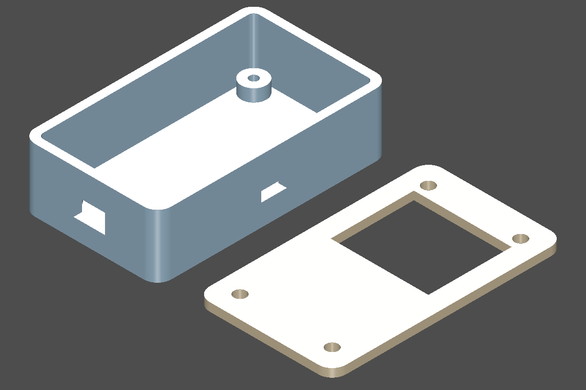

# PCB enclosure

Build and adapt a tray and screw-on lid for a rectangular circuit board. The
tray has board supports and connector openings; the lid has screw holes, an
alignment lip, and an optional antenna or display window.



The preview separates the parts for visibility. `example.py` exports the tray
and lid together in their assembled coordinate frame.

This recipe is adapted from [Santiago Ariza's contribution in PR #271](https://github.com/jdilla1277/agentcad/pull/271).
Its helpers and board format live in `enclosure.py`, ready to copy and change.

## Files

| File | Purpose |
| --- | --- |
| `enclosure.py` | `BoardSpec`, tray and lid builders, and local geometry helpers |
| `example.py` | A complete agentcad script using those helpers |
| `board.json` | Example board dimensions, openings, hardware, and clearances |
| `checks.json` | Assertions for the exported example STEP |
| `agentcad.toml` | Keeps generated artifacts under `build/` |
| `tests/` | Input validation, geometry, copying, and export checks |

## Copy and run

Use Python 3.10–3.12 with `agentcad` installed. Copy this entire directory into
your project and run the commands **from the copied directory**:

```console
agentcad init --name pcb-enclosure --runtime build123d
agentcad run example.py --label pcb_v1 --render iso
```

The run reports the exported STEP as `outputs.step`. Pass that path to:

```console
agentcad check-spec <outputs.step> checks.json
```

The sample produces a tray measuring 32.77 × 55.91 × 15.2 mm and a lid measuring
32.77 × 55.91 × 3.2 mm. The checks require two solids, four 2.9 mm cylindrical
features, and four 2.05 mm cylindrical features. Geometry tests additionally
check the openings, supports, keepouts, and full lid screw passages.

These checks establish specific geometric properties. They do not establish
physical fit, screw length, manufacturing tolerances, or antenna performance.

## Adapt it

Edit `board.json` to change the dimensions and `enclosure.py` to change the
design. `example.py` shows how to load a local helper file with `run_path`;
use the same pattern when combining copied features in a larger script.

- `board`: width, height, thickness, and corner radius, in millimeters. The
  radius must be less than half the smaller side; rounded-end outlines are
  unsupported by this recipe.
- `mounting_holes`: hole centers and diameters. Optional boss and pilot
  diameters let you change the support geometry.
- `cutouts`: a board edge, distance along that edge, width, and vertical range.
  Bottom/top edges use X; left/right edges use Y. `z_min_mm` defaults to zero;
  supply `height_mm` or an absolute `z_max_mm`. Openings cut through the tray
  wall and any lid lip in the same passage, including openings near the rim.
- `lid_windows`: rectangular openings positioned by their lower-left XY corner.
- `keepouts`: boxes `[xmin, ymin, zmin, xmax, ymax, zmax]` subtracted from both
  parts. Boxes may extend below the board or outside its outline.
- `heights`: support height, maximum component heights, and lid clearance.
- `case`: wall, floor, board clearance, and screw size. The defaults include a
  2 mm lid, a 1.2 mm lip, 1.2 mm lip thickness, and 0.2 mm lip clearance. Set
  `lid_lip_mm` to zero to omit the lip, or `lid` to `none` and omit the lid build.

Update the example checks when changing the design. For a different attachment
method, board outline, or support arrangement, adapt the Python functions.

## Coordinate frame

The board's lower-left corner is `(0, 0)` and its underside is `z = 0`.
The board top is `z = board.thickness_mm`. Supports end at `z = 0`; the floor
starts at `z = -(standoff + floor)`. The tray rim is at
`z = thickness + top_max + lid_clearance`. The lid plate starts at the rim
and its lip extends down into the tray. Cutout and keepout Z values use this
same frame.

## Example dimensions and assumptions

The following dimensions come from the contributor's example and its stated
interpretation of a board drawing. The original drawing is not bundled here;
check the measurements for your actual board before adapting this example.

| Item | Value | Source in the contribution |
| --- | --- | --- |
| Board outline | 28.17 × 51.31 mm | Drawing |
| Board thickness | 1.60 mm | Assumed |
| Board corner radius | 1.00 mm | Assumed |
| Mounting holes | Four, diameter 3.00 mm, 3.00 mm from each edge | Drawing diameter; inset assumed |
| USB opening | 7.62 × 4.65 mm, centered on the bottom edge | Drawing; center derived |
| Button opening | 6.15 × 2.41 mm, right edge, center Y = 25.71 mm | Drawing; edge and Z offset assumed |
| Antenna window | 23.50 × 20.00 mm at X = 2.30, Y = 25.50 mm | Interpreted drawing region |
| Antenna keepout | Same XY footprint, board top to rim | Assumed |
| Support height | 3.00 mm | Assumed |
| Maximum bottom / top component height | 1.50 / 8.50 mm | Assumed |
| Lid clearance | 0.50 mm | Assumed |
| Wall / floor thickness | 2.00 / 1.60 mm | Assumed |
| Board-to-wall clearance | 0.30 mm | Assumed |
| Fasteners | M2.5 | Assumed |

The example leaves the wall closed near the top connector and pin rows because
the contribution does not supply dimensions for an opening there. It assumes
those components fit below the lid. Hardware sizes are recipe choices; choose
screw length and fit for the actual assembly and manufacturing process.

## Test

With the repository's development dependencies installed, from its root:

```console
python -m pytest recipes/pcb_enclosure
```
